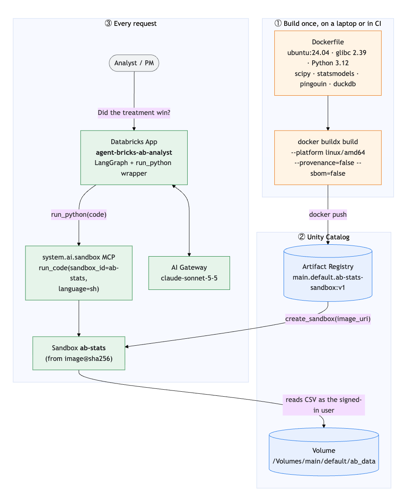

# agentbricks-custom-sandbox

An [Agent Bricks](https://docs.databricks.com/aws/en/agents/custom-agents/agent-bricks-cli) agent
that runs its code in a **Databricks Sandbox built from your own container image**. The example
is an A/B-test analyst. It answers "did the treatment win?" by running scipy, statsmodels,
pingouin and duckdb in a pinned `ubuntu:24.04` / Python 3.12 runtime, reading experiment data from
a Unity Catalog volume as the signed-in user.

Companion code for the blog post [`blog/post.md`](blog/post.md).



## Layout

```
sandbox-image/            Dockerfile, requirements.txt (direct deps), requirements.lock.txt (pip freeze
                          of the pushed image), build_and_push.sh (amd64, no attestations)
scripts/
  create_sandbox.py       create a sandbox from the image (SDK) and smoke-test it
  wait_for_acceleration.sh  poll Artifact Registry until image acceleration is SUCCESS
  seed_data.py            generate the synthetic checkout-button experiment (50k visitors, fixed seed)
  reference_analysis.py   the "ground truth" analysis used to check the agent (runs in the image)
  sandbox_mcp.py          inspect the system.ai.sandbox MCP tools (tools/list, tools/call)
  record_demo.sh, redact.py helpers used to record the demo assets
ab-analyst/               the agent (agentbricks init, LangGraph template)
  agent/custom_sandbox.py pins the managed sandbox tool to $AB_SANDBOX_ID  <- the interesting part
  agent/agent.py          + system prompt, + one line wiring pin_to_custom_sandbox()
  app.yaml                AB_SANDBOX_ID=ab-stats
  agent.toml              sandbox tool binding (system.ai.sandbox, auth = "user")
  tests/test_custom_sandbox.py
blog/                     the post, images, demo video/GIF
```

## Prerequisites

- A Databricks workspace with the **Databricks Sandbox** (Beta) and **Artifact Registry**
  (Public Preview) previews enabled.
- Databricks CLI ≥ 1.18 with an **OAuth** profile (`databricks auth login --profile my-ws`).
- Docker with `buildx`, plus [`uv`](https://docs.astral.sh/uv/) and
  `uv tool install databricks-agentbricks` (tested with CLI 0.10.0; the project runtime resolved to 0.11.0).
- On the target schema (default `main.default`): `USE CATALOG`, `USE SCHEMA`, `CREATE VOLUME`,
  `READ VOLUME`.

## Quickstart

```bash
export PROFILE=my-ws

# 1. Build for linux/amd64 (required, even on Apple silicon) and push to Artifact Registry
./sandbox-image/build_and_push.sh v1
#    behind a TLS-inspecting proxy / private mirror:
#    EXTRA_BUILD_ARGS="--secret id=extra_ca,src=ca.pem --build-arg PIP_INDEX_URL=https://mirror/simple" ./sandbox-image/build_and_push.sh v1

# 2. Wait for image acceleration (prints the digest)
./scripts/wait_for_acceleration.sh main.default.ab-stats-sandbox v1

# 3. Create the sandbox, pinned by digest
cd ab-analyst && uv sync && cd ..
DATABRICKS_CONFIG_PROFILE=$PROFILE uv run --project ab-analyst python scripts/create_sandbox.py \
  ab-stats "main.default.ab-stats-sandbox@sha256:<digest>"

# 4. Put the experiment data in a UC volume
uv run --project ab-analyst python scripts/seed_data.py data/checkout_button_test.csv
databricks volumes create main default ab_data MANAGED --profile $PROFILE
databricks fs cp data/checkout_button_test.csv dbfs:/Volumes/main/default/ab_data/ --profile $PROFILE

# 5. Run locally, then deploy
cd ab-analyst
cp .env.example .env && echo "DATABRICKS_CONFIG_PROFILE=$PROFILE" >> .env
agentbricks -p $PROFILE dev          # http://localhost:8000
agentbricks -p $PROFILE deploy       # -> agent-bricks-ab-analyst on Databricks Apps
agentbricks -p $PROFILE tracing list # every invocation is an MLflow trace (tool calls, latency, tokens)
```

To check the agent's numbers yourself, run the reference analysis in the same image:

```bash
tar -cf - scripts/reference_analysis.py data/checkout_button_test.csv | \
  docker run --rm -i --platform linux/amd64 ab-stats-sandbox:v1 \
  bash -c 'mkdir -p /w && tar -xf - -C /w && python3 /w/scripts/reference_analysis.py /w/data/checkout_button_test.csv'
```

Then ask: *"We ran a checkout-button test. Data: /Volumes/main/default/ab_data/checkout_button_test.csv.
Did the treatment win, and should we ship it?"*

> **New workspace?** `agent.toml` names the memory and session stores and the tracing experiment
> created when this project was scaffolded. They are created on first deploy if they don't
> exist, so you can keep or rename them.

## How the pinning works

`agentbricks tools add sandbox` binds the managed `system.ai.sandbox` MCP service, which exposes
`create_sandbox`, `run_code` and `delete_sandbox`. `run_code` accepts a `sandbox_id` of an owned
sandbox, including one created with the Sandbox API. `agent/custom_sandbox.py`:

- hides `create_sandbox` / `delete_sandbox` from the model;
- replaces `run_code` with `run_python(code)`, which always sends `sandbox_id=$AB_SANDBOX_ID` and
  `language="sh"`, ships the script base64-encoded and runs the image's `python3`;
- keeps calls on the managed tool object, so auth mode and `agent.toml` policy still apply.

## Notes

- `run_code` only runs in sandboxes the caller owns. With `auth = "user"`, the pinned sandbox
  works for its owner. For a shared app, create one sandbox per user from the image, or use
  `--auth app` with a sandbox owned by the app's service principal.
- Pin `image_uri` by digest. Never bake credentials into the image.
- Tests: `cd ab-analyst && uv run pytest`.

## Cleanup

```bash
agentbricks -p $PROFILE deployments delete agent-bricks-ab-analyst
databricks sandbox delete ab-stats --profile $PROFILE
databricks volumes delete main.default.ab_data --profile $PROFILE
```
