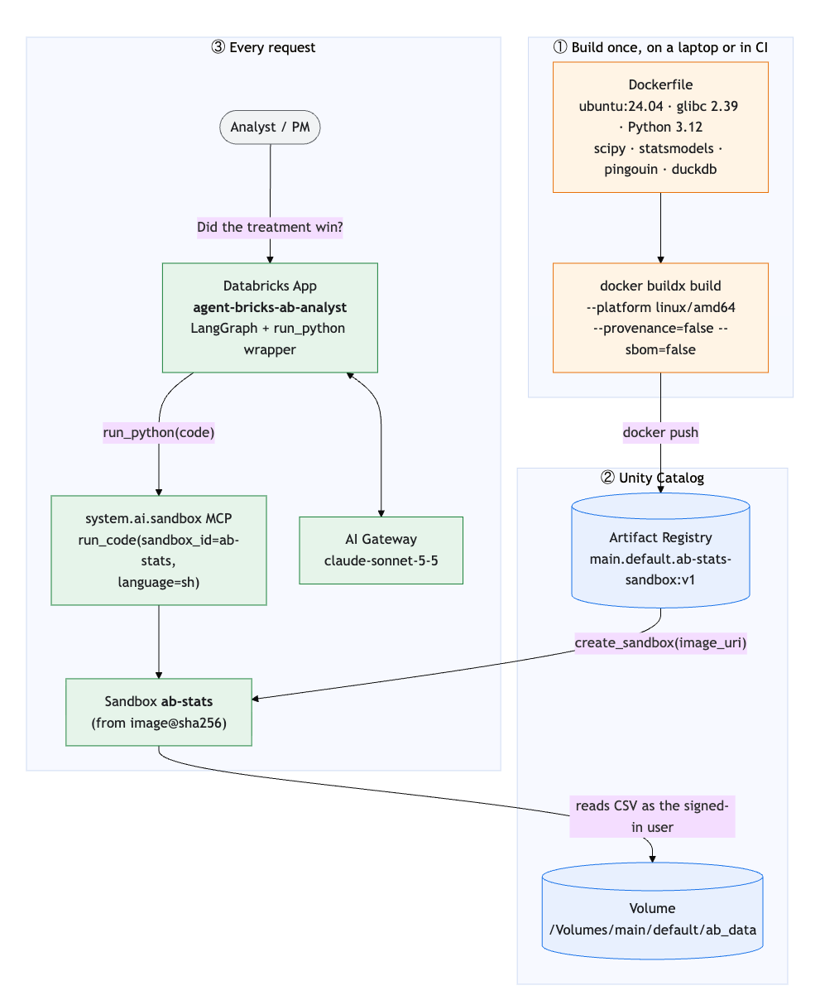
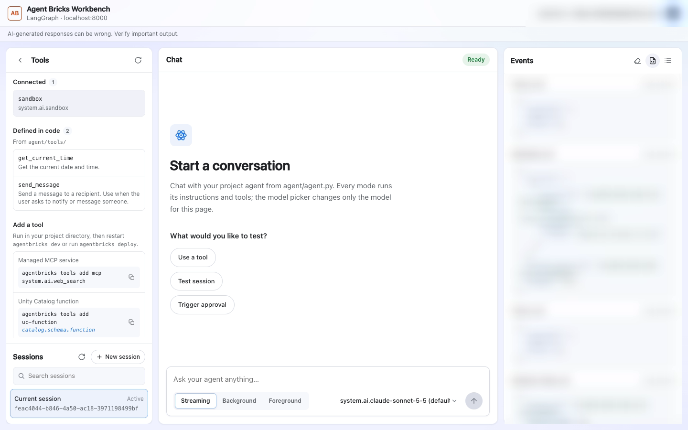
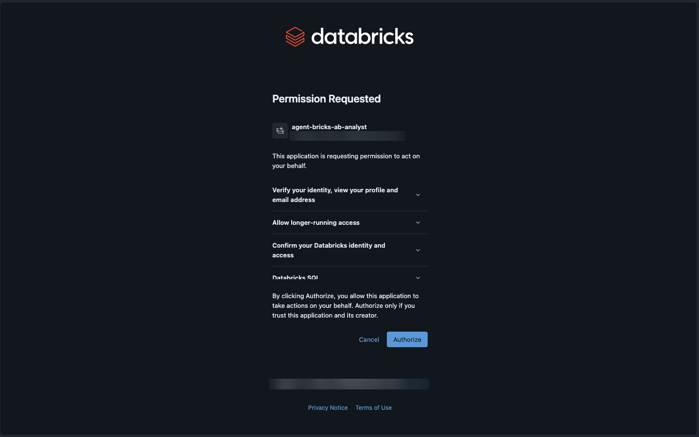
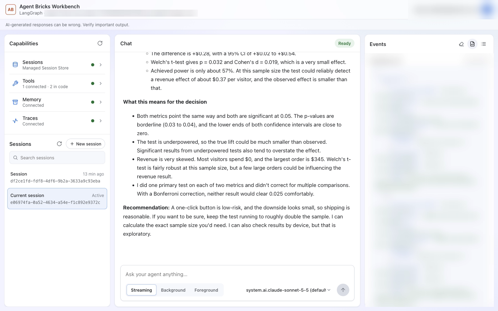
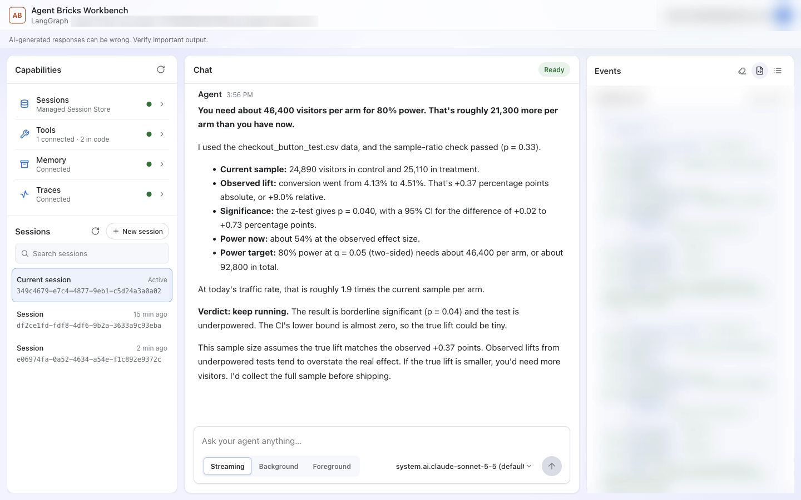

# Bring Your Own Runtime: Giving an Agent Bricks Agent a Custom Sandbox

*How I built an A/B-test analyst agent that runs real statistics in a sandbox I control, using a Docker image built on my laptop, the Agent Bricks CLI, and about 50 lines of glue code.*


*The deployed agent at 2.5× speed. The full-length recording is [`img/demo-deployed.mp4`](img/demo-deployed.mp4) (55 s).*

---

## TL;DR

- **Databricks Sandbox** gives an agent an isolated microVM to run code in. When the default image doesn't have your toolchain, you can [start sandboxes from your own container image](https://docs.databricks.com/aws/en/compute/serverless/sandbox-custom-image) stored in [Artifact Registry](https://docs.databricks.com/aws/en/artifact-registry/).
- I built an `ubuntu:24.04` image (glibc 2.39, Python 3.12) with a pinned stats stack: scipy, statsmodels, pingouin and duckdb. I pushed it to Unity Catalog and created a sandbox from it.
- I scaffolded the agent with the **[Agent Bricks CLI](https://docs.databricks.com/aws/en/agents/custom-agents/agent-bricks-cli)**, added the managed `system.ai.sandbox` tool, and pinned that tool to my sandbox with a small wrapper. Then I deployed it with `agentbricks deploy`.
- A product manager asks "did the treatment win?" and gets a verdict in 20–40 seconds in my runs, computed with the same pinned library versions every time.
- On Apple silicon, **build for `linux/amd64`** (sandboxes are x86_64). I also turn off provenance attestations so the push is a plain single-platform manifest. That's the configuration I verified end to end.

**Code:** everything here is in the companion repo, [`esiol-db/agentbricks-custom-sandbox`](https://github.com/esiol-db/agentbricks-custom-sandbox).

---

## The problem: "just pip install it" doesn't scale

A product team runs an experiment and asks: *did the new checkout button win?* Answering properly takes a short, specific playbook. You need a sample-ratio-mismatch (SRM) check, a two-proportion z-test ([statsmodels](https://www.statsmodels.org/stable/generated/statsmodels.stats.proportion.proportions_ztest.html)), a Welch t-test on revenue with effect size and power ([pingouin](https://pingouin-stats.org/generated/pingouin.ttest.html)), and an honest caveat or two.

An LLM is good at writing that analysis and bad at running it in its head, so you give it a code-execution tool. Databricks Sandbox is built for this: an isolated, serverless microVM with a persistent home directory, reachable through the API, the SDK, the CLI, or as a managed tool for agents ([docs](https://docs.databricks.com/aws/en/compute/serverless/sandbox)).

When I checked the default sandbox image, it had pandas and scipy. **statsmodels, pingouin and duckdb were not installed.** The obvious fix is to have the agent `pip install` them at the start of every run. I didn't want that, for three reasons:

1. **Latency.** Every fresh sandbox waits on a dependency install before the analysis starts, and the user is the one waiting.
2. **Reproducibility.** "Latest pingouin" today is not latest pingouin next quarter. When the question is *should we ship?*, I want the p-value to come from a known library version.
3. **Egress and supply chain.** Runtime installs need package-index access from the sandbox, and you re-trust the supply chain on every run instead of once.

A custom image moves all three to build time. You build once, scan once and pin by digest. Every sandbox starts from the same environment, and the image is a Unity Catalog object with its own grants.

### Why it's worth it, and when it isn't

For the business, the point is that an analyst's statistical playbook becomes something a PM can query in plain English, without waiting in the analyst's queue. As built here it's a single-owner pilot. See the production notes for what it takes to share it with a team. In my runs, question to verdict took **20 to 40 seconds**, including two or three sandbox executions and zero install time. Because sandbox code runs with the **signed-in user's** Unity Catalog permissions, reading data through the agent is governed by the same grants as reading it directly. Every tool call is traced. Security reviews one image instead of every ad-hoc `pip install`.

The cost is that you now own an image pipeline: build, push, wait for acceleration, re-pin on upgrades. The docs also note that sandboxes from custom images can take longer to start than the default environment ([limitations](https://docs.databricks.com/aws/en/compute/serverless/sandbox-custom-image)). **Skip it** if the default image already covers your libraries, if the work is exploratory and one-off, or if your dependencies change faster than you'd rebuild an image.

---

## What we're building



Three phases:

1. **Build once.** A Dockerfile on `ubuntu:24.04`, cross-built for `linux/amd64` and pushed to Artifact Registry as `main.default.ab-stats-sandbox:v1`.
2. **Create the sandbox.** One SDK call with `image_uri` set to the image digest gives a sandbox named `ab-stats`.
3. **Every request.** The agent, hosted on Databricks Apps, calls the managed `system.ai.sandbox` MCP tool with `sandbox_id="ab-stats"`. The code runs inside my image and reads the experiment from a Unity Catalog volume.

**Prerequisites:**
- A workspace with the **Databricks Sandbox** (Beta) and **Artifact Registry** (Public Preview) previews enabled ([manage previews](https://docs.databricks.com/aws/en/admin/workspace-settings/manage-previews)).
- The Databricks CLI ≥ 1.18 with an OAuth profile. I used CLI 1.26.0 and the `agentbricks` CLI 0.10.0. The project's runtime library (`databricks-agentbricks[langgraph]>=0.10.0`) resolved to 0.11.0.
- Docker with `buildx`, plus `uv` and `jq`.
- `USE CATALOG`, `USE SCHEMA`, `CREATE VOLUME` and `READ VOLUME` on the target schema ([Artifact Registry permissions](https://docs.databricks.com/aws/en/artifact-registry/get-started)).

**Repo setup.** The helper scripts use the agent project's Python environment and read your profile from the environment:

```bash
git clone https://github.com/esiol-db/agentbricks-custom-sandbox.git && cd agentbricks-custom-sandbox
(cd ab-analyst && uv sync)                 # installs databricks-sdk, pandas, … for the scripts too
export PROFILE=my-ws DATABRICKS_CONFIG_PROFILE=my-ws
```

In the steps below, `python scripts/…` means `uv run --project ab-analyst python scripts/…`.

---

## Agent Bricks CLI in two minutes

The [Agent Bricks CLI](https://docs.databricks.com/aws/en/agents/custom-agents/agent-bricks-cli) (`agentbricks`) is the code-first way to build agents on Databricks. You write the agent logic, in LangGraph or the OpenAI Agents SDK. The CLI handles the platform side: model access through AI Gateway, tools, memory and session stores, tracing, and deployment to Databricks Apps. The command set is small:

```bash
uv tool install databricks-agentbricks

agentbricks init my-agent          # scaffold a LangGraph (default) or OpenAI Agents SDK project
agentbricks tools add sandbox      # give it a managed code-execution tool
agentbricks dev                    # run locally with a chat UI on :8000
agentbricks deploy                 # ship it to Databricks Apps
```

Tools, stores and tracing are declared in an `agent.toml` manifest, and `deploy` reconciles them. It creates the stores, grants the app access and wires up tracing. The scaffold's default model is `system.ai.claude-sonnet-5-5`, served through AI Gateway, so there are no keys to manage. The docs label the CLI Beta, and its own `--help` calls it experimental, with preview APIs that may change. Check `agentbricks <command> --help` after upgrades ([command reference](https://github.com/databricks/databricks-ai-bridge/blob/main/integrations/agentbricks/cli.md)).

Out of the box, `agentbricks tools add sandbox` gives the agent sandboxes from the **default** image. The rest of this post points that tool at **your** image.

---

## Step 1: Build the image and check it locally

The [custom-image requirements](https://docs.databricks.com/aws/en/compute/serverless/sandbox-custom-image) are short: glibc 2.25 or newer, and no musl-based images such as Alpine. `ubuntu:24.04` ships glibc 2.39 and Python 3.12 as system packages ([glibc](https://launchpad.net/ubuntu/noble/+source/glibc), [python3.12](https://launchpad.net/ubuntu/noble/+source/python3.12)), so there's no need for a third-party Python base. Abridged, the Dockerfile looks like this (the repo version adds optional proxy support):

```dockerfile
# syntax=docker/dockerfile:1
FROM ubuntu:24.04
ENV DEBIAN_FRONTEND=noninteractive PIP_NO_CACHE_DIR=1 MPLBACKEND=Agg

RUN apt-get update \
 && apt-get install -y --no-install-recommends python3 python3-venv python3-pip ca-certificates curl \
 && rm -rf /var/lib/apt/lists/*

# The stats stack lives in a venv that is first on PATH, so `python3` means our Python.
ARG PIP_INDEX_URL=https://pypi.org/simple
COPY requirements.txt /tmp/requirements.txt
RUN python3 -m venv /opt/venv \
 && /opt/venv/bin/pip install --upgrade pip \
 && /opt/venv/bin/pip install -r /tmp/requirements.txt
ENV PATH="/opt/venv/bin:${PATH}"

# Fail the build, not the agent, if something is missing.
RUN python3 -c "import scipy, statsmodels, pingouin, duckdb, pandas, matplotlib"
```

`requirements.txt` pins the eight direct dependencies: pandas 3.1.1, pyarrow 26.0.1, numpy 2.5.5, scipy 1.18.1, statsmodels 0.15.0, pingouin 0.7.0, duckdb 1.5.6 and matplotlib 3.11.2. Their transitive dependencies (scikit-learn, xarray and so on) resolve at build time, so two builds a month apart can differ. What freezes the full environment is the **image digest**. For a rebuildable record, the repo also ships `requirements.lock.txt`, the `pip freeze` of the image I pushed, with 31 packages.

### The Apple silicon gotcha

**Sandboxes run on `linux/amd64`.** In my sandbox, `platform.platform()` reported `Linux-6.18.60-x86_64-with-glibc2.39` (you'll see it in the Step 7 output too). Build on an M-series Mac without saying so and you get an arm64 image, which an x86_64 microVM can't run. The second thing to know is less obvious. `docker buildx` attaches a [provenance attestation](https://docs.docker.com/build/metadata/attestations/) by default, which turns the push into a manifest *index* with an extra `unknown/unknown` platform entry next to your image. If a sandbox fails to start from an image you pushed off a Mac, an unexpected index is one of the first things to rule out. I sidestep it with `--provenance=false --sbom=false`, so the registry receives a plain single-platform manifest ([multi-platform builds](https://docs.docker.com/build/building/multi-platform/)). That's the setup I verified end to end.

Build a local copy first and check it. **Do this before pushing**, because Artifact Registry doesn't serve blobs back to Docker clients, so you can't inspect the pushed image afterwards ([limitations](https://docs.databricks.com/aws/en/artifact-registry/)):

```console
$ docker buildx build --platform linux/amd64 --provenance=false --sbom=false \
    -t ab-stats-sandbox:v1 --load sandbox-image/
$ docker image inspect ab-stats-sandbox:v1 --format '{{.Os}}/{{.Architecture}}'
linux/amd64
$ docker run --rm --platform linux/amd64 ab-stats-sandbox:v1 bash -c 'ldd --version | head -1; python3 --version'
ldd (Ubuntu GLIBC 2.39-0ubuntu8.9) 2.39
Python 3.12.3
```

On an M-series Mac the amd64 build runs under emulation. The `pip install` layer took about two minutes, and later builds come from cache. The result is about 300 MB compressed as pushed (five layers) and 1.3 GB unpacked.

> **Building behind a corporate proxy?** My first build failed with `CERTIFICATE_VERIFY_FAILED`, because the network inspects TLS. The repo's Dockerfile optionally accepts the proxy CA as a [BuildKit secret](https://docs.docker.com/build/building/secrets/) (`--secret id=extra_ca,src=ca.pem`) and a package mirror via `--build-arg PIP_INDEX_URL=…`. A secret is mounted only for that one `RUN` step, so the CA never lands in a layer.

## Step 2: Push to Artifact Registry

Artifact Registry stores container images as Unity Catalog objects named `catalog.schema.artifact`. Docker authenticates through a credential helper that the Databricks CLI installs ([get started](https://docs.databricks.com/aws/en/artifact-registry/get-started)):

```bash
# `databricks auth docker` is marked (Experimental) in CLI 1.26's help.
databricks auth docker configure --profile my-ws      # one-time: installs the credential helper
REGISTRY=$(databricks auth docker host --profile my-ws -o json | jq -r .host)
# -> <workspace-id>.container.<region>.cloud.databricks.com

docker buildx build --platform linux/amd64 --provenance=false --sbom=false \
  -t "$REGISTRY/main.default.ab-stats-sandbox:v1" --push sandbox-image/
```

This is the same build as Step 1 with a different tag and `--push`, so every layer comes from cache and only the upload takes time. In the repo, `PROFILE=my-ws ./sandbox-image/build_and_push.sh v1` runs these three commands for you. Set `ARTIFACT=catalog.schema.name` to push somewhere other than `main.default`. The workspace OAuth token Docker uses expires after an hour. If a big push fails authorization partway through, run it again so the helper fetches a fresh token ([Artifact Registry](https://docs.databricks.com/aws/en/artifact-registry/)). For other auth or push errors, see the [troubleshooting guide](https://docs.databricks.com/aws/en/artifact-registry/troubleshooting).

The image can't be used as soon as the push finishes. Databricks first *accelerates* it, and you wait for `image_acceleration_details.status` to read `SUCCESS`. The same response gives you the digest you'll pin in the next step:

```console
$ databricks api get --profile my-ws \
    "/api/2.1/unity-catalog/software-artifacts/main.default.ab-stats-sandbox/versions"
{
  "software_artifact_versions": [{
    "digest": "sha256:1c1464abc8866b98db0e3984e4b4082c35bba6896c9d706313e300e5b1fbcd51",
    "tags": ["v1"],
    "image_acceleration_details": { "status": "SUCCESS" }
  }]
}
```

The docs say acceleration can take 15 minutes or more. My 300 MB image was ready in about a minute. `PROFILE=my-ws scripts/wait_for_acceleration.sh main.default.ab-stats-sandbox v1` polls until it's done and prints the digest.

## Step 3: Create the sandbox and load the data

One SDK call. I pin by **digest** rather than tag, because a tag can be moved to another image and a digest can't:

```python
from databricks.sdk import WorkspaceClient
from databricks.sdk.service.sandbox import EnvironmentSpec, Sandbox, SandboxSpec

w = WorkspaceClient()
sb = w.sandbox.create_sandbox(
    sandbox=Sandbox(
        display_name="A/B test analyst (stats stack)",
        spec=SandboxSpec(environment=EnvironmentSpec(
            image_uri="main.default.ab-stats-sandbox@sha256:<digest>")),  # digest from Step 2
    ),
    sandbox_id="ab-stats",
)
```

`scripts/create_sandbox.py` waits for `SANDBOX_STATE_RUNNING` and runs a smoke test with `execute_command_sync` ([SDK usage](https://docs.databricks.com/aws/en/compute/serverless/sandbox-quickstart)):

```console
$ python scripts/create_sandbox.py ab-stats "main.default.ab-stats-sandbox@sha256:<digest>"   # output trimmed
created sandboxes/ab-stats
running after 29s
PRETTY_NAME="Ubuntu 24.04.5 LTS"
ldd (Ubuntu GLIBC 2.39-0ubuntu8.9) 2.39
Python 3.12.3
scipy 1.18.1 | statsmodels 0.15.0 | pingouin 0.7.0 | duckdb 1.5.6
```

Next, the data. `scripts/seed_data.py` generates a synthetic checkout-button experiment with a fixed seed: 50,000 visitors with variant, device, a conversion flag and revenue. Everyone who runs it gets the same CSV. I put it in a Unity Catalog volume, which the sandbox mounts under `/Volumes` and reads with the caller's permissions ([volumes](https://docs.databricks.com/aws/en/volumes/)):

```bash
python scripts/seed_data.py data/checkout_button_test.csv
databricks volumes create main default ab_data MANAGED --profile my-ws
databricks fs cp data/checkout_button_test.csv dbfs:/Volumes/main/default/ab_data/ --profile my-ws
```

## Step 4: Scaffold the agent and add the sandbox tool

```bash
agentbricks -p my-ws init --name ab-analyst ab-analyst
cd ab-analyst
agentbricks tools add sandbox
```

The last command adds one binding to `agent.toml`:

```toml
[[tools]]
id = "sandbox"
auth = "user"                                         # code runs as the signed-in user
source = {kind = "sandbox", service = "system.ai.sandbox"}
policy = {databricks_access_token_included = true}
```

`system.ai.sandbox` is a Databricks-managed MCP service ([built-in MCP services](https://docs.databricks.com/aws/en/agents/mcp-tools/built-in-mcp-services)) with three tools: `create_sandbox`, `run_code` and `delete_sandbox`. This post depends on one detail of `run_code`: its **`sandbox_id`** argument. The tool's own schema describes it as "an owned sandbox from create_sandbox, an earlier run_code call, **or the Sandbox API**". That means the managed tool can target a sandbox you built yourself. `scripts/sandbox_mcp.py list` prints the full schema if you want to see it.

## Step 5: Pin the tool to your sandbox

Left alone, the model decides whether to create a sandbox and which one to use. I want the opposite: the model writes Python, and the **server** decides where it runs. `agent/custom_sandbox.py` hides `create_sandbox` and `delete_sandbox`, and replaces `run_code` with a `run_python(code)` tool that always targets `$AB_SANDBOX_ID`:

```python
def _shell_for(code: str) -> str:
    # base64 so quotes, heredocs and backslashes in the model's code survive the shell
    payload = base64.b64encode(code.encode()).decode()
    return f"cd /tmp && echo {payload} | base64 -d > cell.py && python3 cell.py"


def _pinned_run_python(run_code: BaseTool, sandbox_id: str) -> BaseTool:
    async def run_python(code: str, timeout_seconds: int = 120):
        return await run_code.ainvoke({
            "sandbox_id": sandbox_id,      # chosen by the server, never by the model
            "language": "sh",
            "code": _shell_for(code),
            "timeout_seconds": timeout_seconds,
        })

    return StructuredTool.from_function(
        coroutine=run_python, name="run_python", args_schema=RunPythonArgs,
        description="Run a Python script in the team's statistics sandbox. Python 3.12 with "
                    "pinned packages: pandas 3.1, numpy 2.5, scipy 1.18, statsmodels 0.15, "
                    "pingouin 0.7, duckdb 1.5, matplotlib 3.11. These are newer than many "
                    "examples you know: print a result's columns before indexing into it …",
    )
```

Wiring it in takes an import and one call in `agent/agent.py`, right after the template loads its MCP tools. The analyst system prompt goes in the same file:

```python
mcp = await mcp_tools(build_mcp_servers(), workspace_client_for=workspace_client_for)
mcp = pin_to_custom_sandbox(mcp)
```

The sandbox ID lives in `app.yaml`. `agentbricks dev` and the deployed app both read their environment from that file, so one setting covers both:

```yaml
command: ["uv", "run", "start-server"]
env:
  - name: AB_SANDBOX_ID
    value: "ab-stats"
```

Some of this isn't obvious from the code.

**Calls still go through the managed tool.** I wrap the `run_code` tool object the CLI already built, so its identity handling, auth mode and `agent.toml` policy all still apply. The wrapper only fixes *which* sandbox the code runs in and *how* it's started.

**Shell mode, with the image's own `python3`.** On a custom image I call `run_code` with `language: "sh"` and run Python myself. In my tests, the tool's stateful `language: "python"` mode returned an error on the plain Ubuntu image, while shell mode ran inside it without trouble. The trade-off is that each call is a fresh process with no state from earlier calls, so the tool description tells the model to reload the data in every script.

**Tell the model what you pinned.** On my first recorded run, the model indexed pingouin's result with `'cohen-d'`, the column name from older releases. Pingouin 0.7 calls it `cohen_d`, so it hit a `KeyError`. It recovered on its own, but that cost a round trip. After I listed the exact versions in the tool description, the next run was clean and took 30 seconds instead of 40. That's a single before-and-after pair, but the failure mode is real: pinning the runtime is only half the job if the model is still writing code for a different one.

A unit test, `tests/test_custom_sandbox.py`, locks in the guarantee. The model sees only `run_python(code, timeout_seconds)`, and every call goes out with `sandbox_id="ab-stats"` and `language="sh"`.

## Step 6: Try it locally

```bash
agentbricks dev     # http://localhost:8000
```

`agentbricks dev` wraps `databricks apps run-local`, so local runs behave like the deployment. The bundled Workbench UI shows the binding as connected:



I asked the question a PM would: *"We ran a checkout-button test (new one-click button vs. current). Data: /Volumes/main/default/ab_data/checkout_button_test.csv. Did the treatment win, and should we ship it?"* The agent wrote two scripts, both sent to `ab-stats`. The first profiled the data. The second, below, ran the SRM check, the z-test with its confidence interval, and a Welch t-test with power:


## Step 7: Deploy

```bash
agentbricks -p my-ws deploy
```

```console
✔ Deployed agent 'agent-bricks-ab-analyst'
URL              https://agent-bricks-ab-analyst-<workspace-id>.aws.databricksapps.com
Memory store     ab-analyst-…-memory
Session store    ab-analyst-…-sessions
Store access     granted to app service principal
Deployed in 3m43s
```

The first deploy took 3 minutes 43 seconds, and the one redeploy I timed took 57 seconds. One thing to watch before you commit: `deploy` writes the runtime settings it needs into your local `app.yaml`. After my deploy it held `MLFLOW_TRACKING_URI`, `MLFLOW_EXPERIMENT_ID`, `AGENT_MEMORY_STORE`, `AGENT_SESSION_STORE`, the package-index variables and several `DATABRICKS_AGENTBRICKS_RUNTIME_STORE_*` entries with workspace-specific values. The repo's `app.yaml` holds only `AB_SANDBOX_ID`. Review that diff and keep only your own settings in version control, since deploy adds the rest each time.

The binding uses `auth = "user"`, so on first visit each user approves the app acting on their behalf. From then on, sandbox code runs with *their* Unity Catalog permissions, not the app's ([app authorization](https://docs.databricks.com/aws/en/dev-tools/databricks-apps/auth)):



You can also call the deployed agent from a terminal. The quickest proof that it uses your image is to ask it:

```bash
agentbricks -p my-ws endpoint invoke agent-bricks-ab-analyst --path /api/invocations -o json --json '{
  "id": "6f1c2a9e-3b7d-4c55-9a8e-2d4f6b1e0c37",
  "session_id": "check-1",
  "input": [{"role": "user", "content": "Print the OS, glibc, Python, pingouin and statsmodels versions, then count rows in /Volumes/main/default/ab_data/checkout_button_test.csv."}]
}'
```

(`"input": [...]` is the message-list shorthand. Use `{"messages": [...], "actor": ...}` when you need to control which memory partition a conversation uses.) The `run_python` result inside the JSON response, trimmed, came back in 21 seconds:

```text
OS: Linux 6.18.60 Linux-6.18.60-x86_64-with-glibc2.39
libc: ('glibc', '2.39')
PRETTY_NAME="Ubuntu 24.04.5 LTS"
Python: 3.12.3 (main, Aug 31 2026, 10:18:26) [GCC 13.3.0]
pingouin: 0.7.0
statsmodels: 0.15.0
lines incl header: 50001 data rows: 50000
```

Here is the hosted app while the agent was still streaming. The chat shows pingouin's output from the sandbox, and the Events panel records the `run_python` call with `"status": "success"`:


## What the agent concluded

The deployed agent's numbers match `scripts/reference_analysis.py`, which I ran separately in the same image (the README has the one-line `docker run`):

| Check | Result |
|---|---|
| Sample ratio (24,890 vs 25,110) | χ² p = 0.33, so no mismatch |
| Conversion | 4.134% → 4.508%, +0.374 pp (95% CI +0.02 to +0.73), z-test p = 0.040 |
| Revenue per visitor | $2.37 → $2.65, Welch's t-test p = 0.032, Cohen's d = 0.019 |
| Achieved power, revenue test | ≈ 57% |
| Achieved power, conversion test | ≈ 54% |

The numbers alone would have been easy to misread, and the caveats are what made the answer usable. The agent called both results significant at 0.05 but borderline, with confidence intervals that nearly touch zero. It pointed out that the test is underpowered, and that significant results from underpowered tests tend to overstate the effect. It noted that revenue is heavily skewed: most visitors spend $0 and the largest order is $345. It also flagged that it hadn't corrected for multiple comparisons, and said neither result would clear a Bonferroni threshold of 0.025 "comfortably". Strictly, neither clears it at all, since both p-values (0.040 and 0.032) are above 0.025. Its recommendation: the one-click button is low-risk, so shipping is reasonable, but for certainty, keep the test running until the sample roughly doubles.



In a separate session I asked for an exact number. It computed about **46,400 visitors per arm** for 80% power on the conversion lift, about 21,300 more per arm than the test had. The reference script gets 46,385.



One more experiment changed how I think about this. I sent the *identical* question to the deployed agent three more times. Every run came back with p = 0.040 and p = 0.032, but the headlines differed:

| Run | Time | Headline verdict |
|---|---|---|
| Local, recorded | 30 s | "I'd keep the test running rather than call it a clear win." |
| Deployed #1 | 37 s | "I'd ship it, with some caution." |
| Deployed #2 | 36 s | "Lean ship, but it's borderline." |
| Deployed #3 | 23 s | "I'd ship it, or run it a bit longer if a false positive would be costly." |

The pinned runtime makes the **numbers** reproducible. It does nothing for the model's **judgment**, which is sampled fresh every time. If your team has a decision rule, such as "ship only if the lower CI bound clears X and power ≥ 80%", put it in the system prompt so the verdict follows the rule rather than varying from run to run.

---

## Want your own front end?

The Workbench UI is a developer tool. For an internal product, build the UI with **[AppKit](https://developers.databricks.com/docs/appkit/v0/)**, Databricks' TypeScript and React SDK for Apps. There are two ways to wire it up:

- **Keep this agent standalone** and call its HTTP API from your AppKit app: `POST /api/invocations`, with SSE streaming and a `session_id` per conversation. This fits when several apps or services share one agent.
- **Move the agent into the app** with AppKit's **[Agents plugin](https://developers.databricks.com/docs/appkit/v0/plugins/agents)** (beta). It serves agents defined in your app at built-in chat routes and traces every tool call. The docs explain [when to choose it over a standalone Agent Bricks agent](https://developers.databricks.com/docs/apps/agentic-features).

## Production notes

- **Sandbox ownership.** `run_code` only runs in sandboxes the caller owns. With `auth = "user"`, the pinned sandbox works for the user who created it, which suits a personal tool or a pilot. For a shared app, either create one sandbox per user from the same image on first use, or re-add the tool with `agentbricks tools add sandbox --auth app`, let the app's service principal own the sandbox, and grant that principal access to the data.
- **Pin by digest** in `image_uri`. Tags can move, but versions are immutable ([Artifact Registry](https://docs.databricks.com/aws/en/artifact-registry/)).
- **Know what's pinned.** The digest freezes the *sandbox*, where the statistics run. The agent app's own Python dependencies resolve from the package index on each deploy, and the repo doesn't ship a `uv.lock`. Commit one generated against your own index if you need the app layer frozen too.
- **Grants.** Anyone who creates a sandbox from the image needs `USE CATALOG`, `USE SCHEMA` and `READ VOLUME` on the image's schema ([custom images](https://docs.databricks.com/aws/en/compute/serverless/sandbox-custom-image)). The data needs its own grants.
- **No secrets in the image.** Artifact versions are immutable and the registry doesn't support delete requests ([get started](https://docs.databricks.com/aws/en/artifact-registry/get-started)). A credential baked into a layer stays there. Use build secrets.
- **Preview status.** Sandbox is Beta, Artifact Registry is Public Preview, and the Agent Bricks CLI is experimental. Pin your CLI version and re-check `--help` when you upgrade.

## What's next

There's an open **draft** PR in the public `databricks-ai-bridge` repo, [#828](https://github.com/databricks/databricks-ai-bridge/pull/828), that adds `agentbricks tools add sandbox --image-uri catalog.schema.image:tag`. It records the image in `agent.toml`, so the managed tool can create sandboxes from your image directly. If it lands, the pinning wrapper in this post gets simpler. The image itself, the amd64 rule and "tell the model what you pinned" all still apply.

## Cleanup

```bash
agentbricks -p my-ws deployments delete agent-bricks-ab-analyst   # add -y in scripts
databricks sandbox delete ab-stats --profile my-ws          # add --auto-approve in scripts
databricks volumes delete main.default.ab_data --profile my-ws
```

## Wrapping up

The default sandbox is a fine general-purpose environment. Once an agent's answers depend on specific libraries, though, the runtime is part of the product, and it deserves the same treatment as code: built once, versioned, pinned and governed. With a custom image, one SDK call and a small wrapper around the managed tool, the agent gets exactly the libraries it needs, and the PM gets numbers they can rerun and audit. The best place to start is the amd64 build. Get that right and the rest is mostly configuration.

---

## References

1. Agent Bricks CLI. Databricks docs. https://docs.databricks.com/aws/en/agents/custom-agents/agent-bricks-cli
2. Agent Bricks CLI command reference. GitHub, `databricks/databricks-ai-bridge`. https://github.com/databricks/databricks-ai-bridge/blob/main/integrations/agentbricks/cli.md
3. Databricks Sandbox overview. https://docs.databricks.com/aws/en/compute/serverless/sandbox
4. Databricks Sandbox quickstart (agent tool, CLI and SDK). https://docs.databricks.com/aws/en/compute/serverless/sandbox-quickstart
5. Create a sandbox from a custom image (requirements, troubleshooting, limitations). https://docs.databricks.com/aws/en/compute/serverless/sandbox-custom-image
6. Artifact Registry overview and limitations. https://docs.databricks.com/aws/en/artifact-registry/
7. Get started with Artifact Registry (auth, grants, push, acceleration). https://docs.databricks.com/aws/en/artifact-registry/get-started
8. Troubleshoot Artifact Registry. https://docs.databricks.com/aws/en/artifact-registry/troubleshooting
9. Built-in MCP services (`system.ai.sandbox`). https://docs.databricks.com/aws/en/agents/mcp-tools/built-in-mcp-services
10. Databricks Apps authorization (user authorization). https://docs.databricks.com/aws/en/dev-tools/databricks-apps/auth
11. Unity Catalog volumes. https://docs.databricks.com/aws/en/volumes/
12. Manage Databricks previews. https://docs.databricks.com/aws/en/admin/workspace-settings/manage-previews
13. AppKit documentation. https://developers.databricks.com/docs/appkit/v0/
14. AppKit Agents plugin. https://developers.databricks.com/docs/appkit/v0/plugins/agents
15. Agentic features in Databricks Apps (Agents plugin vs. Agent Bricks CLI). https://developers.databricks.com/docs/apps/agentic-features
16. databricks-ai-bridge PR #828, "Let sandbox tools select a Unity Catalog custom image" (draft). https://github.com/databricks/databricks-ai-bridge/pull/828
17. Docker: multi-platform builds. https://docs.docker.com/build/building/multi-platform/
18. Docker: build attestations. https://docs.docker.com/build/metadata/attestations/
19. Docker: build secrets. https://docs.docker.com/build/building/secrets/
20. Ubuntu 24.04 (noble) glibc source package (2.39). https://launchpad.net/ubuntu/noble/+source/glibc
21. Ubuntu 24.04 (noble) python3.12 source package (3.12.3). https://launchpad.net/ubuntu/noble/+source/python3.12
22. statsmodels `proportions_ztest`. https://www.statsmodels.org/stable/generated/statsmodels.stats.proportion.proportions_ztest.html
23. pingouin `ttest`. https://pingouin-stats.org/generated/pingouin.ttest.html
