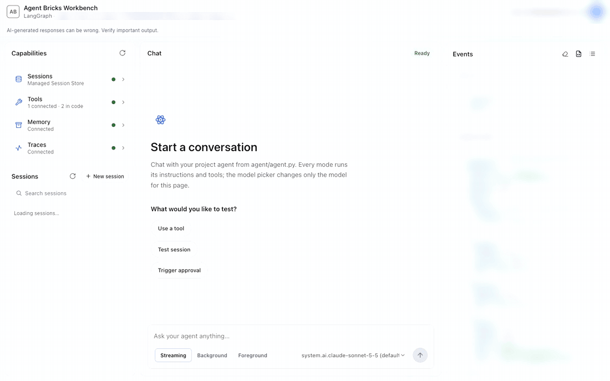
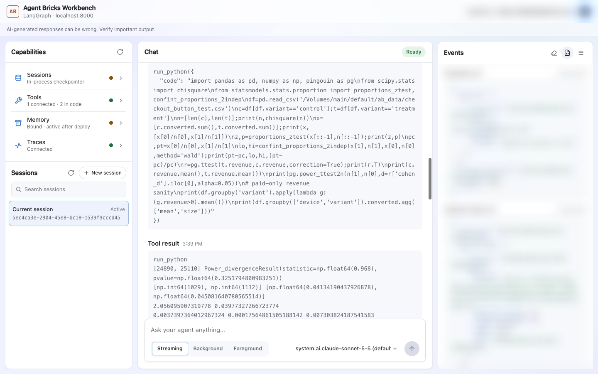
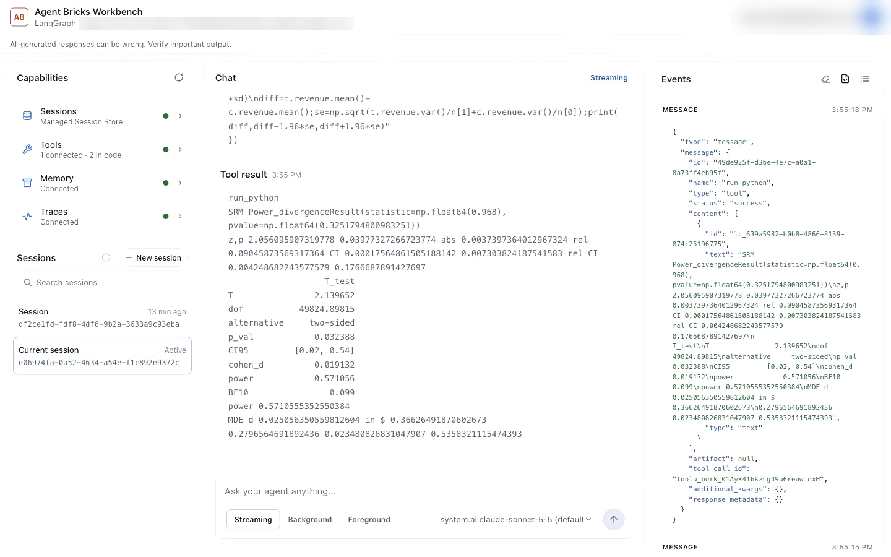
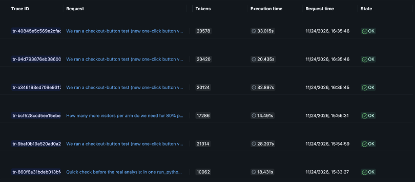
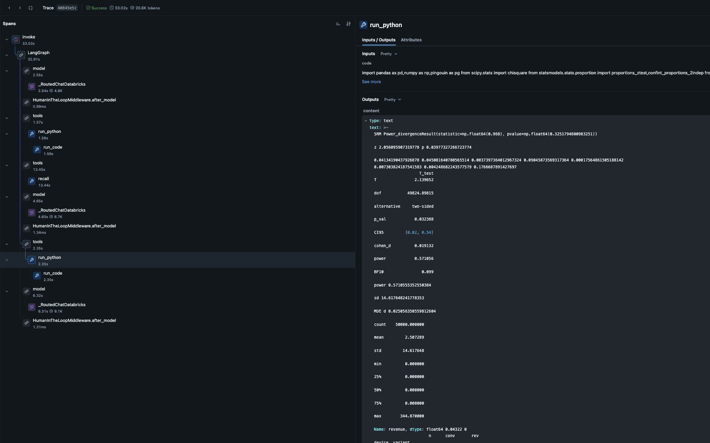
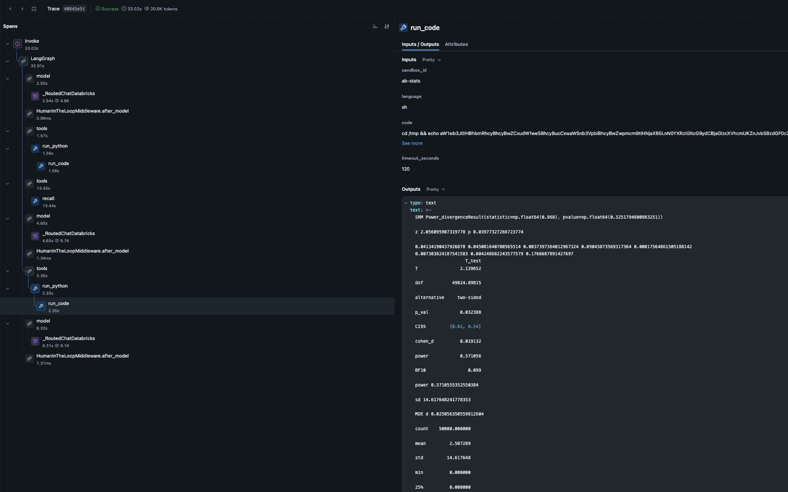

# Bring Your Own Runtime: Giving an Agent Bricks Agent a Custom Sandbox

*How I gave an Agent Bricks agent a sandbox with scipy, statsmodels and pingouin preinstalled, from a Docker image built on my laptop, and what its MLflow traces showed.*


*The deployed agent at 2.5× speed. [Full recording (55 s, MP4)](img/demo-deployed.mp4).*

---

## TL;DR

- Databricks Sandbox can start from [your own container image](https://docs.databricks.com/aws/en/compute/serverless/sandbox-custom-image). I built one on `ubuntu:24.04` (glibc 2.39, Python 3.12) with scipy, statsmodels, pingouin and duckdb preinstalled.
- The [Agent Bricks CLI](https://docs.databricks.com/aws/en/agents/custom-agents/agent-bricks-cli) gave me an agent with a managed sandbox tool in two commands (`agentbricks init` and `agentbricks tools add sandbox`). Pointing that tool at my sandbox took a 78-line Python module, plus one line in `agent.py`, a system prompt and an environment variable.
- In the MLflow traces, the four deployed analyses in this post took 20–33 seconds each, and their numbers matched a reference analysis I ran separately.
- On Apple silicon, **build for `linux/amd64`**. Every sandbox I ran reported x86_64 (the docs don't state the architecture), so an arm64 image is the wrong build for it.
- Code: [github.com/esiol-db/agentbricks-custom-sandbox](https://github.com/esiol-db/agentbricks-custom-sandbox)

---

## Why not just `pip install` at runtime?

A product team asks: *did the new checkout button win?* A proper answer needs a sample-ratio check, a two-proportion z-test ([statsmodels](https://www.statsmodels.org/stable/generated/statsmodels.stats.proportion.proportions_ztest.html)), a Welch t-test on revenue ([pingouin](https://pingouin-stats.org/generated/pingouin.ttest.html)), a power calculation, and a plain statement of what the data can't tell you.

An LLM can write that code but can't reliably run it in its head. [Databricks Sandbox](https://docs.databricks.com/aws/en/compute/serverless/sandbox) gives it an isolated environment on serverless compute to run code in. In my run of a default-image sandbox, pandas and scipy imported fine, but statsmodels, pingouin and duckdb raised `ModuleNotFoundError`.

Installing them on every run has three costs. The user waits on pip before any analysis starts. The answer drifts as library versions move. And every run re-trusts the package index. A custom image does that work at build time instead: you build once, review once, pin by digest, and use Unity Catalog grants to control who can use the image.

For a team, the PM gets a first read on an experiment without waiting for an analyst, and the analyst reviews a trace instead of redoing the work. Security also has one image to review instead of every runtime install. I didn't benchmark runtime installs, so I can't quantify the saving. In a full analysis, the sandbox calls themselves took 3.9 seconds.

Skip all this if the default image already has your libraries, if the work is one-off, or if your dependencies change faster than you'd rebuild. You also take on an image build to maintain, and the docs note that "sandboxes created from a custom image can take longer to start than sandboxes that use the default environment."

## What we're building


*How the pieces connect: the image is built once, stored in Unity Catalog, and used by every request.*

- **① Build once:** cross-build the image for `linux/amd64` on your laptop.
- **② Store in Unity Catalog:** push it to [Artifact Registry](https://docs.databricks.com/aws/en/artifact-registry/) as `main.default.ab-stats-sandbox:v1`, then create the sandbox `ab-stats` from its digest. The experiment data sits in a volume in the same schema.
- **③ Every request:** the model writes Python, and a small wrapper sends it to the managed `system.ai.sandbox` tool with `sandbox_id="ab-stats"`. The code runs in my image and reads the volume with the signed-in user's permissions.

You'll need:
- a workspace with the Databricks Sandbox (Beta) and Artifact Registry (Public Preview) [previews enabled](https://docs.databricks.com/aws/en/admin/workspace-settings/manage-previews)
- the Databricks CLI ≥ 1.18 with an OAuth profile
- Docker with `buildx`, plus `uv` (and `jq` if you run the Step 2 commands by hand)
- `USE CATALOG` on the catalog, and `USE SCHEMA`, `CREATE VOLUME` and `READ VOLUME` on the schema, that will hold the image and the data (`main.default` here)

I used Databricks CLI 1.26.0 and the `agentbricks` CLI 0.10.0. The project's runtime library resolved to 0.11.0.

```bash
git clone https://github.com/esiol-db/agentbricks-custom-sandbox.git && cd agentbricks-custom-sandbox
(cd ab-analyst && uv sync)                         # one environment for the agent and the helper scripts
export PROFILE=my-ws DATABRICKS_CONFIG_PROFILE=my-ws
```

In the steps below, `python scripts/…` is short for `uv run --project ab-analyst python scripts/…`.

## A two-minute tour of the Agent Bricks CLI

`agentbricks` is a CLI for building agents in code on Databricks. You write the agent in [LangGraph](https://langchain-ai.github.io/langgraph/) or the OpenAI Agents SDK. The CLI handles model access through [AI Gateway](https://docs.databricks.com/aws/en/ai-gateway/) (the default model is `system.ai.claude-sonnet-5-5`, with no keys to manage), tools, memory and session stores, MLflow tracing, and deployment to Databricks Apps.

```bash
uv tool install databricks-agentbricks
agentbricks init my-agent          # scaffold a project (LangGraph by default)
agentbricks tools add sandbox      # give it a managed code-execution tool
agentbricks dev                    # chat with it locally on :8000
agentbricks deploy                 # ship it to Databricks Apps
```

Tools, stores and tracing live in an `agent.toml` manifest, and `deploy` creates whatever it declares. The docs list the CLI as Beta and its `--help` calls it experimental, so recheck `--help` after upgrades ([command reference](https://github.com/databricks/databricks-ai-bridge/blob/main/integrations/agentbricks/cli.md)). Out of the box, `tools add sandbox` uses the default image. The rest of this post points it at yours.

## Step 1: Build the image

The requirements for a custom image are short: glibc 2.25 or newer, and no musl-based images such as Alpine. Ubuntu 24.04 ships glibc 2.39 and Python 3.12 as system packages, so you don't need a separate Python base image. Here's the Dockerfile, abridged. The [full version](https://github.com/esiol-db/agentbricks-custom-sandbox/blob/main/sandbox-image/Dockerfile) adds the proxy secret, the mirror argument and a pip upgrade:

```dockerfile
FROM ubuntu:24.04
ENV DEBIAN_FRONTEND=noninteractive PIP_NO_CACHE_DIR=1 MPLBACKEND=Agg

RUN apt-get update \
 && apt-get install -y --no-install-recommends python3 python3-venv python3-pip ca-certificates curl \
 && rm -rf /var/lib/apt/lists/*

# A venv first on PATH, so `python3` in the sandbox means this Python.
COPY requirements.txt /tmp/requirements.txt
RUN python3 -m venv /opt/venv && /opt/venv/bin/pip install -r /tmp/requirements.txt
ENV PATH="/opt/venv/bin:${PATH}"

# Fail the build, not the agent, if something is missing.
RUN python3 -c "import scipy, statsmodels, pingouin, duckdb, pandas, matplotlib"
```

`requirements.txt` pins the eight direct dependencies: scipy 1.18.1, statsmodels 0.15.0, pingouin 0.7.0, duckdb 1.5.6, pandas 3.1.1 and three more. Transitive dependencies resolve at build time, so the digest is what freezes the full environment. `requirements.lock.txt` records a `pip freeze` of the image I pushed.

> **On Apple silicon.** When my deployed agent ran `platform.platform()` inside a sandbox, it reported `Linux-6.18.60-x86_64-with-glibc2.39`. Build on an M-series Mac without `--platform linux/amd64` and you push an arm64 image, the wrong architecture for that host.
>
> I also pass `--provenance=false --sbom=false`. By default `buildx` attaches a [provenance attestation](https://docs.docker.com/build/metadata/attestations/), which turns the push into a manifest index with an extra `unknown/unknown` entry. Without it, the registry receives a plain single-platform manifest. Step 2 shows how to check.

Build a local copy and check it before you push. After pushing, you can still read the manifest with `docker buildx imagetools inspect`, but you can't pull the image back out of Artifact Registry to run it ([limitations](https://docs.databricks.com/aws/en/artifact-registry/)):

```console
$ docker buildx build --platform linux/amd64 --provenance=false --sbom=false -t ab-stats-sandbox:v1 --load sandbox-image/
$ docker image inspect ab-stats-sandbox:v1 --format '{{.Os}}/{{.Architecture}}'
linux/amd64
$ docker run --rm --platform linux/amd64 ab-stats-sandbox:v1 bash -c 'ldd --version | head -1; python3 --version'
ldd (Ubuntu GLIBC 2.39-0ubuntu8.9) 2.39
Python 3.12.3
```

Under emulation on my Mac, with packages coming through a corporate mirror, the `pip install` layer took about two minutes. The five pushed layers total 298.6 MB compressed.

My first build failed with `CERTIFICATE_VERIFY_FAILED`, because the corporate network inspects TLS. The repo's Dockerfile takes the proxy CA as a [build secret](https://docs.docker.com/build/building/secrets/), which never lands in the image, and an optional package mirror:

```bash
EXTRA_BUILD_ARGS="--secret id=extra_ca,src=$PWD/ca.pem --build-arg PIP_INDEX_URL=https://mirror.example.com/simple" \
  ./sandbox-image/build_and_push.sh v1
```

Build args are recorded in the image history, so only pass ones you don't mind people seeing.

## Step 2: Push it to Artifact Registry

Artifact Registry stores images as Unity Catalog objects named `catalog.schema.artifact`. The Databricks CLI installs a Docker credential helper for you ([get started](https://docs.databricks.com/aws/en/artifact-registry/get-started)):

```bash
databricks auth docker configure --profile my-ws          # one-time (marked Experimental in CLI 1.26)
REGISTRY=$(databricks auth docker host --profile my-ws -o json | jq -r .host)

docker buildx build --platform linux/amd64 --provenance=false --sbom=false \
  -t "$REGISTRY/main.default.ab-stats-sandbox:v1" --push sandbox-image/
```

It's the same build as before, so every layer comes from cache and only the upload takes time. `./sandbox-image/build_and_push.sh v1` wraps all three commands, then prints `imagetools inspect` so you can confirm the push is a single manifest rather than an index:

```console
$ docker buildx imagetools inspect "$REGISTRY/main.default.ab-stats-sandbox:v1"
Name:      $REGISTRY/main.default.ab-stats-sandbox:v1
MediaType: application/vnd.oci.image.manifest.v1+json
Digest:    sha256:1c1464abc8866b98db0e3984e4b4082c35bba6896c9d706313e300e5b1fbcd51
```

A pushed image can't be used until Databricks has accelerated it. The docs warn that this can take 15 minutes or more. Mine already read `SUCCESS` on my first poll, 48 seconds after the version appeared. `scripts/wait_for_acceleration.sh` does the polling and prints the digest you'll pin next:

```console
$ PROFILE=my-ws scripts/wait_for_acceleration.sh main.default.ab-stats-sandbox v1
15:17:08 +0m  SUCCESS sha256:1c1464abc8866b98db0e3984e4b4082c35bba6896c9d706313e300e5b1fbcd51
```

## Step 3: Create the sandbox and load the data

Pin by digest. A tag can be moved to another image; a digest can't:

```python
from databricks.sdk import WorkspaceClient
from databricks.sdk.service.sandbox import EnvironmentSpec, Sandbox, SandboxSpec

WorkspaceClient().sandbox.create_sandbox(
    sandbox=Sandbox(spec=SandboxSpec(environment=EnvironmentSpec(
        image_uri="main.default.ab-stats-sandbox@sha256:<digest>"))),
    sandbox_id="ab-stats",
)
```

`scripts/create_sandbox.py` does this, waits for the sandbox to start, and runs a smoke test with `execute_command_sync` ([quickstart](https://docs.databricks.com/aws/en/compute/serverless/sandbox-quickstart)):

```console
$ python scripts/create_sandbox.py ab-stats "main.default.ab-stats-sandbox@sha256:<digest>"     # trimmed
running after 29s
PRETTY_NAME="Ubuntu 24.04.5 LTS"
ldd (Ubuntu GLIBC 2.39-0ubuntu8.9) 2.39
Python 3.12.3
scipy 1.18.1 | statsmodels 0.15.0 | pingouin 0.7.0 | duckdb 1.5.6
```

The data is a synthetic checkout-button experiment, generated with a fixed seed so you get the same 50,000 rows I did. It goes in a [Unity Catalog volume](https://docs.databricks.com/aws/en/volumes/), which the sandbox mounts under `/Volumes`:

```bash
python scripts/seed_data.py data/checkout_button_test.csv
databricks volumes create main default ab_data MANAGED --profile my-ws
databricks fs cp data/checkout_button_test.csv dbfs:/Volumes/main/default/ab_data/ --profile my-ws
```

## Step 4: Scaffold the agent

If you cloned the repo, `ab-analyst/` is already scaffolded and the binding below is already in place, so skip the two commands. Starting from scratch, run this in a directory where `ab-analyst` doesn't exist yet:

```bash
agentbricks -p my-ws init --name ab-analyst ab-analyst && cd ab-analyst
agentbricks tools add sandbox
```

The second command adds one binding to `agent.toml`:

```toml
[[tools]]
id = "sandbox"
auth = "user"                                          # code runs as the signed-in user
source = {kind = "sandbox", service = "system.ai.sandbox"}
policy = {databricks_access_token_included = true}
```

[`system.ai.sandbox`](https://docs.databricks.com/aws/en/agents/mcp-tools/built-in-mcp-services) is a Databricks-managed MCP service with three tools: `create_sandbox`, `run_code` and `delete_sandbox`. This whole setup relies on `run_code`'s `sandbox_id` argument. The tool's schema (`python scripts/sandbox_mcp.py list` prints it) describes it as "an owned sandbox from create_sandbox, an earlier run_code call, or the Sandbox API". So the managed tool can run code in the sandbox from Step 3.

## Step 5: Pin the tool to your sandbox

Left alone, the model decides which sandbox to use, and can create new ones from the default image. I wanted the server to choose where code runs. `agent/custom_sandbox.py` hides `create_sandbox` and `delete_sandbox`, and wraps `run_code` in a `run_python(code)` tool that always targets `$AB_SANDBOX_ID`. Condensed from the repo:

```python
def _pinned_run_python(run_code: BaseTool, sandbox_id: str) -> BaseTool:
    async def run_python(code: str, timeout_seconds: int = 120):
        script = base64.b64encode(code.encode()).decode()      # survives any quoting in the code
        return await run_code.ainvoke({
            "sandbox_id": sandbox_id,                           # set by the server, never by the model
            "language": "sh",
            "code": f"cd /tmp && echo {script} | base64 -d > cell.py && python3 cell.py",
            "timeout_seconds": timeout_seconds,
        })

    return StructuredTool.from_function(
        coroutine=run_python, name="run_python", args_schema=RunPythonArgs,
        description="Run a Python script in the team's statistics sandbox. Python 3.12 with pinned "
                    "packages: pandas 3.1, scipy 1.18, statsmodels 0.15, pingouin 0.7, duckdb 1.5 … "
                    "Print a result's columns before indexing into it (pingouin uses snake_case, "
                    "e.g. 'cohen_d').")
```

Beyond the template, the agent needs three changes:

- one call in `agent/agent.py`, `mcp = pin_to_custom_sandbox(mcp)`, right after the template loads its MCP tools
- an analyst system prompt in the same file
- the sandbox ID in `app.yaml`:

  ```yaml
  env:
    - name: AB_SANDBOX_ID
      value: "ab-stats"
  ```

`agentbricks dev` generates its local config from `app.yaml`, so that setting covers local runs and the deployed app. A unit test checks that the model only ever sees `run_python(code, timeout_seconds)`.

Three details that matter:

- **Wrap the managed tool.** The wrapper calls the `run_code` tool object the CLI built, so identity, auth mode and the `agent.toml` policy still apply.
- **Use shell mode.** On my custom image, `run_code`'s stateful `language: "python"` mode failed with `spawn Databricks kernel: No such file or directory`, while shell mode worked. Each call is a fresh process, so the model reloads the data every time.
- **Tell the model what you pinned.** Early on, the model used pingouin's old column name `'cohen-d'` and hit a `KeyError` on 0.7's `cohen_d`. Once the tool description listed the versions, the next run was clean, at 30 seconds instead of 40.

## Step 6: Run it locally, then deploy

`agentbricks dev` starts the agent with a chat UI on `localhost:8000`, picking up `AB_SANDBOX_ID` from `app.yaml`. I asked what a PM would ask: *"We ran a checkout-button test (new one-click button vs. current). Data: /Volumes/main/default/ab_data/checkout_button_test.csv. Did the treatment win, and should we ship it?"*

The agent wrote two scripts and ran both in `ab-stats`. The first profiled the data. The second, below, ran the statistics:


*Local run: the second `run_python` call, with the model's code above and the sandbox's output below.*

Then I deployed it:

```console
$ agentbricks -p my-ws deploy
✔ Deployed agent 'agent-bricks-ab-analyst'
Store access     granted to app service principal
Deployed in 3m43s
```

The one redeploy I timed took 57 seconds. Because the tool uses `auth = "user"`, a user's first visit shows a consent screen, and after that, sandbox code reads data with their Unity Catalog permissions ([app authorization](https://docs.databricks.com/aws/en/dev-tools/databricks-apps/auth)). `deploy` also writes its tracing, store and runtime settings into your local `app.yaml`. The repo's copy holds only `AB_SANDBOX_ID`, so review that diff before committing.

Here's the hosted app while the agent is still streaming its answer. Pingouin's output from the sandbox is in the chat, and the Events panel logs the `run_python` call:


*Deployed app, mid-answer: sandbox output in the chat, the tool call in the Events panel.*

## Step 7: See every tool call in MLflow

Tracing needs no extra code. `init` declared an MLflow experiment in `agent.toml`, and `deploy` wired the app to it, so every request becomes a [trace](https://docs.databricks.com/aws/en/mlflow3/genai/tracing/overview). You can list them with `agentbricks tracing list`, or browse them in the experiment's Traces tab:


*Six deployed runs: the 15:33 version check, the 15:54 first analysis, the 15:56 sample-size question, and the three repeat analyses at 16:35. Local runs trace to a local MLflow server, so they don't appear here.*

Click a `run_python` span and you get the script the model wrote, followed by what the sandbox printed: `p_val 0.032388`, `CI95 [0.02, 0.54]` (the revenue-per-visitor difference, in dollars), `power 0.571`. These are the same values the agent quotes in its answer.


*The second `tools` step is a memory `recall` (13.4 s). More on that below.*

Each `run_python` contains a `run_code` span, which is the managed sandbox call the wrapper made. Its inputs show where the code ran: `sandbox_id: ab-stats` and `language: sh`, both set by the server.


*The `run_code` inputs the wrapper set: `sandbox_id: ab-stats`, `language: sh` and the base64-encoded script.*

I expected the sandbox to be the slow part. The trace said otherwise. Some steps overlap, so the rows don't add up to the total:

| Step | Time |
|---|---|
| Two sandbox executions | 1.6 s + 2.3 s |
| Three model calls (20.6K tokens in total) | 2.5 s + 4.7 s + 6.3 s |
| Memory `recall` | 13.4 s |
| Whole request | 33.0 s |

The model asked for `run_python` and the template's long-term memory `recall` at the same moment, 3.2 s into the run. The UI lists them as separate steps. `recall` took 13.4 s against `run_python`'s 1.6 s, and the next model call waited for it, so memory cost about 12 seconds, more than a third of the request. This analyst doesn't need memory, so dropping that binding is my next experiment.

## What the numbers say

I checked the agent's figures against `scripts/reference_analysis.py`, run separately in the same image. They matched:

| Check | Result |
|---|---|
| Sample ratio (24,890 vs 25,110) | χ² p = 0.33, so no mismatch |
| Conversion | 4.134% → 4.508%, +0.374 pp (95% CI +0.02 to +0.73), p = 0.040 |
| Revenue per visitor | $2.37 → $2.65, Welch p = 0.032, Cohen's d = 0.019 |
| Power at the observed effect | ≈ 54% for conversion, ≈ 57% for revenue |

The caveats are the part I'd want a PM to read first. The agent called both results borderline, with confidence intervals that nearly touch zero. It warned that underpowered tests tend to overstate effects, and that revenue is heavily skewed. It also flagged that it hadn't corrected for testing two metrics: at a Bonferroni threshold of 0.025, neither p-value clears the bar.


*The end of the first deployed answer: caveats and recommendation. Its headline is quoted in the table below.*

Asked separately, it worked out that 80% power needs about 46,400 visitors per arm, against today's 25,000, if the true lift is as large as the one observed. The reference script gets 46,385. Both power figures are post-hoc: they say this test was small for an effect this size.

Then I sent the same Step 6 prompt to the deployed agent three more times, in parallel. Across the five runs, the p-values never changed. The headlines did:

| Run | Headline (verbatim excerpt) |
|---|---|
| Local | "…I'd keep the test running rather than call it a clear win." |
| Deployed, first run | "…the evidence is thin. I'd ship it, or run it a bit longer if a false positive would be costly." |
| Deployed, repeat 1 | "…the evidence is modest. I'd ship it, with some caution." |
| Deployed, repeat 2 | "Lean ship, but it's borderline." |
| Deployed, repeat 3 | "…the evidence is borderline. I'd ship it, or run it a bit longer if a false positive would be costly." |

A pinned runtime makes the numbers reproducible. The model's judgment is sampled fresh on every run. If your team has a decision rule, such as "ship only if the lower CI bound is above zero and power is at least 80%", put it in the system prompt so the verdict follows the rule.

## Takeaways

1. **Pin by digest.** The digest freezes the sandbox, but not the agent app around it.
2. **Tell the model what you pinned.** Listing library versions in the tool description saved a failed round trip.
3. **Pin the decision rule as well as the runtime.** Identical numbers gave one "keep running" and four ship-leaning verdicts, each with different conditions.
4. **Check the trace before you tune anything.** Here the slow step was a 13.4 s memory lookup, not the 3.9 s of sandbox work.

## Front end, team use, and the CLI roadmap

**A real front end.** The deployed app serves the same Workbench chat UI, which is fine for a pilot. For a product, build the UI with [AppKit](https://developers.databricks.com/docs/appkit/v0/), Databricks' TypeScript/React SDK for Apps. Either call this agent's `POST /api/invocations` endpoint, or move the agent into the app with the [Agents plugin](https://developers.databricks.com/docs/appkit/v0/plugins/agents) (beta). The docs explain [when to use which](https://developers.databricks.com/docs/apps/agentic-features).

**Sharing it.** `run_code` only runs in sandboxes the caller owns, so with `auth = "user"`, treat this as a single-user pilot. For a team, create a sandbox per user from the same image, or re-add the tool with `--auth app` and let the app's service principal own one. Creating a sandbox from the image needs `USE CATALOG`, `USE SCHEMA` and `READ VOLUME` on the catalog and schema that hold it ([requirements](https://docs.databricks.com/aws/en/compute/serverless/sandbox-custom-image)). Keep credentials out of the image: a pushed digest never changes, and the registry [doesn't accept delete requests](https://docs.databricks.com/aws/en/artifact-registry/get-started).

**A simpler binding.** A draft PR, [databricks-ai-bridge#828](https://github.com/databricks/databricks-ai-bridge/pull/828), adds `agentbricks tools add sandbox --image-uri …`. It would record the image in `agent.toml` and make the wrapper simpler. The image, the amd64 build and the version hints would stay the same.

## Cleanup

```bash
agentbricks -p my-ws deployments delete agent-bricks-ab-analyst
databricks sandbox delete ab-stats --profile my-ws
databricks volumes delete main.default.ab_data --profile my-ws
```

The image stays in Artifact Registry, because the registry doesn't accept delete requests.

---

If you build one of these, start with the Dockerfile and the `docker image inspect` check in Step 1. Then run `agentbricks tools add sandbox` and copy `agent/custom_sandbox.py` from the repo. The rest is one line in `agent.py`, a system prompt, and an `AB_SANDBOX_ID` entry in `app.yaml`.

## Key docs

- [Create a sandbox from a custom image](https://docs.databricks.com/aws/en/compute/serverless/sandbox-custom-image): requirements, acceleration, limitations
- [Artifact Registry](https://docs.databricks.com/aws/en/artifact-registry/): naming, auth, limitations
- [Agent Bricks CLI](https://docs.databricks.com/aws/en/agents/custom-agents/agent-bricks-cli)
- [Built-in MCP services](https://docs.databricks.com/aws/en/agents/mcp-tools/built-in-mcp-services): `system.ai.sandbox`
- [MLflow Tracing](https://docs.databricks.com/aws/en/mlflow3/genai/tracing/overview)
- [AppKit Agents plugin](https://developers.databricks.com/docs/appkit/v0/plugins/agents)
